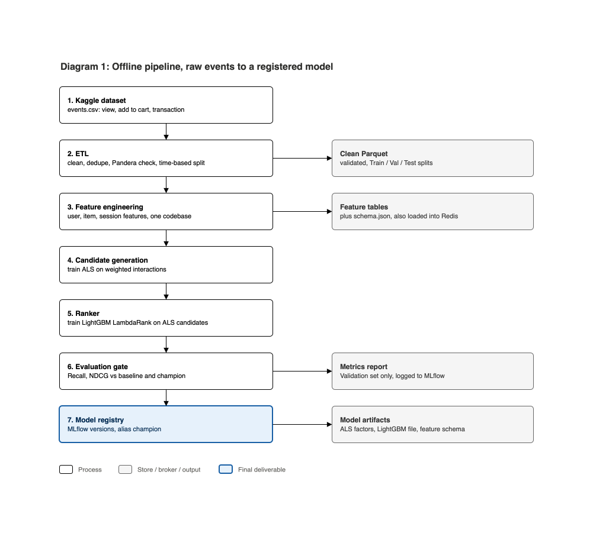
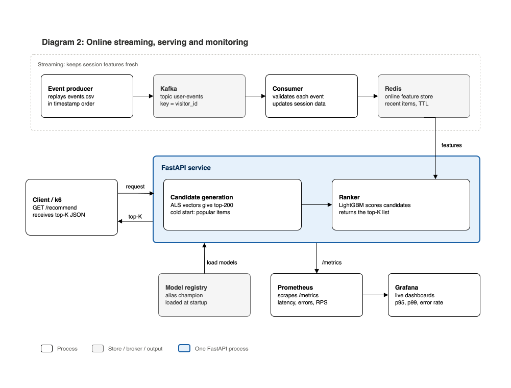
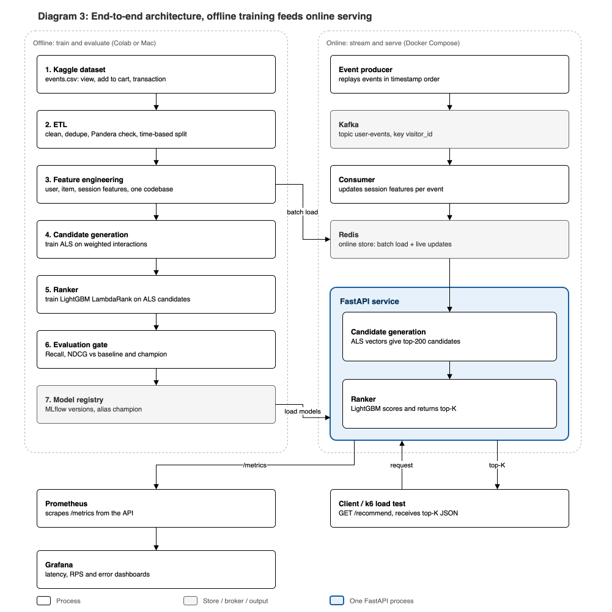

# Real-Time ML Recommender System

> Two-stage recommendation pipeline: from raw events to a low-latency serving API

ระบบแนะนำสินค้าแบบครบวงจร (end-to-end) สำหรับร้านค้าออนไลน์ ตั้งแต่จัดการข้อมูล เทรนโมเดล ไปจนถึง API ที่แนะนำสินค้าให้ผู้ใช้แต่ละคนแบบเรียลไทม์

## เป้าหมาย

- แสดงสินค้าแนะนำให้ผู้ใช้แต่ละคน โดยดูจากพฤติกรรมล่าสุด (ดู, ใส่ตะกร้า, ซื้อ)
- API ตอบเร็วพอใช้งานจริง (เป้าหมาย p95 < 100 ms)
- ออกแบบให้เหมือนงานจริงของ ML Engineer ไม่ใช่แค่ notebook

## Data

**แหล่งที่มา:** [RetailRocket e-commerce dataset](https://www.kaggle.com/datasets/retailrocket/ecommerce-dataset) (Kaggle)

**ลักษณะข้อมูล:** event log จริงของร้านออนไลน์ มี timestamp จึง replay เป็น stream ได้

| Event | ความหมาย |
| --- | --- |
| `view` | ดูสินค้า |
| `addtocart` | ใส่ตะกร้า |
| `transaction` | ซื้อ |

**ไฟล์ที่ใช้:**

| ไฟล์ | ใช้ทำอะไร |
| --- | --- |
| `events.csv` | ข้อมูลหลัก (visitor, item, event, เวลา) |
| `item_properties_part1/2.csv` | ฟีเจอร์สินค้า |
| `category_tree.csv` | ลำดับชั้นหมวดหมู่ |

## แนวคิดหลัก

- **Two-stage model**: ALS ดึง candidate → LightGBM เรียงลำดับ
- **แบ่งข้อมูลตามเวลา** (Train / Val / Test) กัน data leakage
- **Feature ชุดเดียว** ใช้ทั้ง offline และ online
- **Streaming**: Kafka → Redis อัปเดตฟีเจอร์ล่าสุดแบบสด
- **Serving & Monitoring**: FastAPI + Prometheus/Grafana, ทดสอบด้วย k6

## Tech Stack

| Layer | Tools |
| --- | --- |
| Data processing | Polars / DuckDB, Parquet |
| Data validation | Pandera |
| Candidate generation | `implicit` (ALS) |
| Ranking | LightGBM (LambdaRank) |
| Experiment tracking & Model registry | MLflow |
| Streaming | Apache Kafka (KRaft mode) |
| Online feature store | Redis |
| API | FastAPI, Uvicorn, Pydantic |
| Containerization | Docker Compose |
| Monitoring | Prometheus, Grafana |
| Load testing | k6 |
| CI / Code quality | GitHub Actions, pytest, ruff |
| Notebook / GPU | Jupyter, Google Colab |

## System Design

### 1. Offline — ข้อมูลไปจนถึงโมเดล

เปลี่ยน events ดิบให้เป็นโมเดลที่ผ่านการประเมินและลงทะเบียนแล้ว: ETL → Features → ALS → Ranker → Evaluation → Model registry



### 2. Online — Streaming, Serving, Monitoring

ทำงานสองสายพร้อมกัน: สาย streaming (Kafka → Redis) อัปเดตฟีเจอร์ล่าสุด และสาย serving (FastAPI) ตอบ request พร้อมวัดผลด้วย Prometheus/Grafana



### 3. End-to-end — ภาพรวมทั้งระบบ

เชื่อมสองฝั่งด้วย 3 เส้นหลัก: ฟีเจอร์ไป Redis, โมเดลจาก Registry ไป FastAPI, และ metrics จาก FastAPI ไป Prometheus



## Progress

- [x] ออกแบบระบบ
- [x] Setup repo
- [x] EDA
- [x] ETL และแบ่งข้อมูลตามเวลา
- [x] Evaluation และ baseline
- [x] Feature engineering
- [x] ALS + Ranker
- [ ] Serving, Streaming, Docker
- [ ] Load test และ Monitoring

รายละเอียดแต่ละขั้นอยู่ใน [docs/progress.md](docs/progress.md) และวิธีรันเทรนเองอยู่ใน [docs/runbook-training.md](docs/runbook-training.md)

## โครงสร้างโปรเจกต์

```text
src/             # etl, features, training, evaluation, serving, streaming
tests/           # pytest
notebooks/       # EDA
docs/            # progress log และภาพออกแบบระบบ (docs/diagrams)
```

---

**Developed by Suphanat Chanlek**
