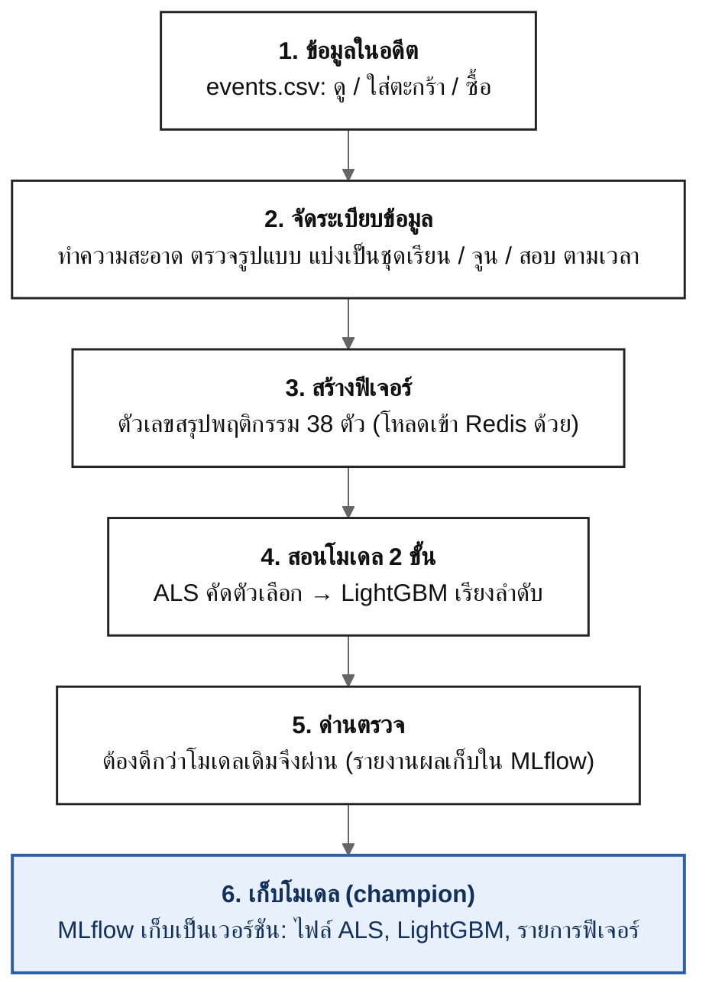
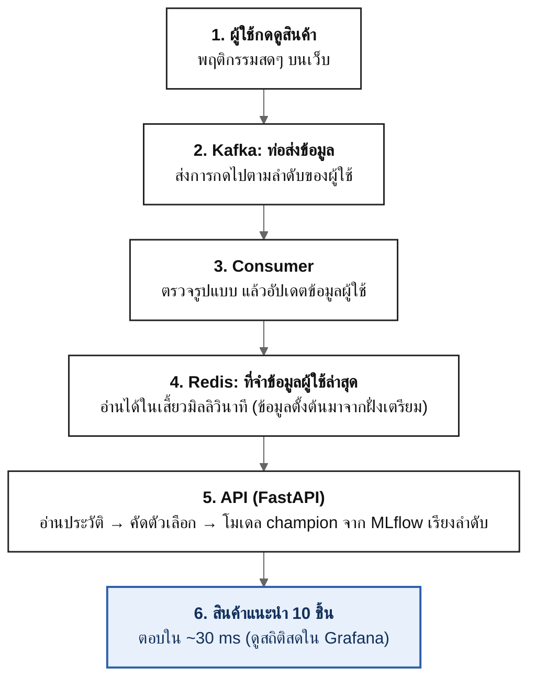
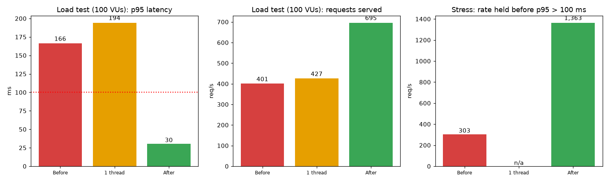
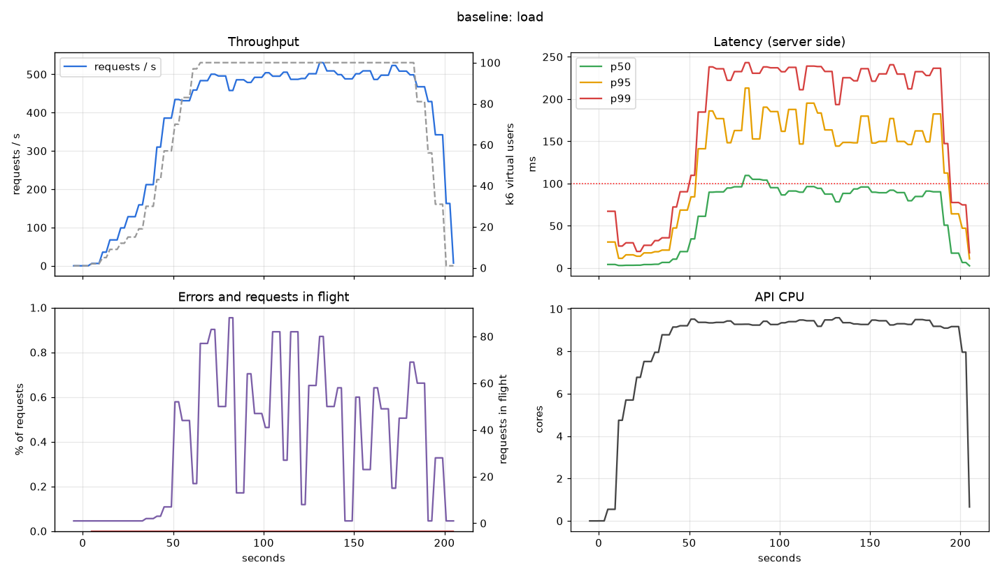
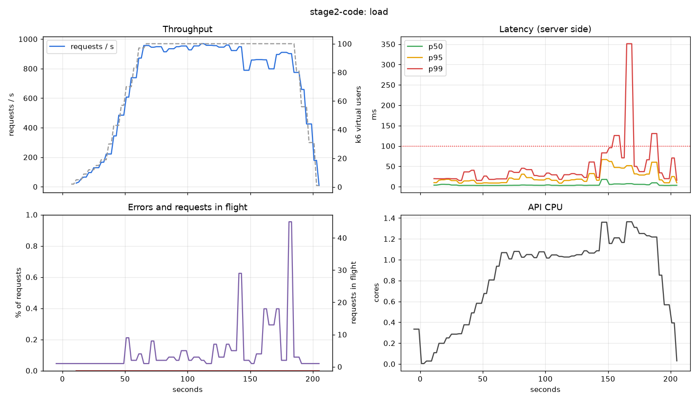
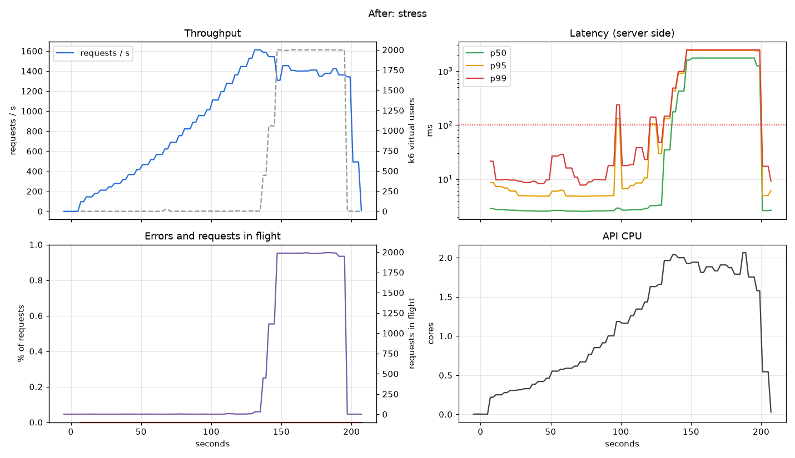

# Real-Time ML Recommender System

> Two-stage recommendation pipeline: from raw events to a low-latency serving API

<p align="center">
  
  
  
  <br>
  
  
  
  <br>
  
  
  
  <br>
  
  
  
  <br>
  
  
  <br>
  
  
  
  <br>
  
  
  
</p>

## โปรเจกต์นี้คืออะไร
เวลาเข้าเว็บร้านค้าออนไลน์แล้วเจอช่อง **"สินค้าที่คุณน่าจะชอบ"** นั่นคือ *ระบบแนะนำสินค้า* (recommender system) โปรเจกต์นี้คือการสร้างระบบแบบนั้นให้ครบทุกขั้น ตั้งแต่ข้อมูลดิบไปจนถึง **API ที่ตอบได้ในไม่กี่มิลลิวินาที**

**ระบบทำอะไร:** รู้ว่าผู้ใช้แต่ละคน *ดู ใส่ตะกร้า และซื้ออะไรมาบ้าง* แล้วแนะนำสินค้า 10 ชิ้นที่เขาน่าจะสนใจที่สุด และเมื่อผู้ใช้กดดูสินค้าใหม่ ระบบก็รับรู้ทันที

**ข้อมูลที่ใช้:** ประวัติการใช้งานจริงของร้านออนไลน์แห่งหนึ่ง ([RetailRocket](https://www.kaggle.com/datasets/retailrocket/ecommerce-dataset)) ประมาณ 2.7 ล้านครั้ง จากผู้ใช้ 1.4 ล้านคน และสินค้า 235,000 ชิ้น

**ทำไมถึงทำ:** เพื่อฝึกทำงานแบบ ML Engineer จริง ไม่ใช่แค่ทดลองใน notebook นั่นคือต้องดูแลทั้งข้อมูล โมเดล ระบบที่รันตลอดเวลา การวัดความเร็ว และการพิสูจน์ว่าถูกต้อง

### ภาพรวมแบบเข้าใจง่าย

**① ฝั่งเตรียม** รันนานๆ ครั้งเพื่อสอนโมเดลจากข้อมูลในอดีต



**② ฝั่งให้บริการ** รันตลอดเวลา รับการกดสดๆ แล้วตอบสินค้าแนะนำ



| อยากรู้ว่า... | ไปอ่านที่ |
| --- | --- |
| ระบบดีแค่ไหน (ผลลัพธ์) | [ผลลัพธ์แบบเข้าใจง่าย](#1-ผลลัพธ์แบบเข้าใจง่าย) |
| ลองรันเอง | [ลองรันดู](#2-ลองรันดู-quick-start) |
| ลองยิง API ด้วย Postman | [ทดสอบ API](#3-ทดสอบ-api-ด้วย-postman) |
| ระบบทำงานอย่างไร | [ระบบทำงานอย่างไร](#5-ระบบทำงานอย่างไร) |
| ใช้เทคโนโลยีอะไร | [เทคโนโลยีที่ใช้](#6-เทคโนโลยีที่ใช้และใช้ทำอะไร) |
| ไม่เข้าใจคำศัพท์ | [คำศัพท์](#11-คำศัพท์) |
| รายละเอียดเชิงเทคนิค | [docs/technical-details.md](docs/technical-details.md) |

## สารบัญ

1. [ผลลัพธ์แบบเข้าใจง่าย](#1-ผลลัพธ์แบบเข้าใจง่าย)
2. [ลองรันดู (Quick start)](#2-ลองรันดู-quick-start)
3. [ทดสอบ API ด้วย Postman](#3-ทดสอบ-api-ด้วย-postman)
4. [ดู Dashboard และทดสอบความเร็ว](#4-ดู-dashboard-และทดสอบความเร็ว)
5. [ระบบทำงานอย่างไร](#5-ระบบทำงานอย่างไร)
6. [เทคโนโลยีที่ใช้และใช้ทำอะไร](#6-เทคโนโลยีที่ใช้และใช้ทำอะไร)
7. [ผลลัพธ์แบบละเอียด](#7-ผลลัพธ์แบบละเอียด)
8. [คำสั่งและการตั้งค่า](#8-คำสั่งและการตั้งค่า)
9. [โครงสร้างโปรเจกต์](#9-โครงสร้างโปรเจกต์)
10. [ข้อจำกัด (พูดตรงๆ) และงานต่อยอด](#10-ข้อจำกัด-พูดตรงๆ-และงานต่อยอด)
11. [คำศัพท์](#11-คำศัพท์)
12. [เอกสารเพิ่มเติม](#12-เอกสารเพิ่มเติม)

## 1. ผลลัพธ์แบบเข้าใจง่าย

| คำถาม | คำตอบ |
| --- | --- |
| **แนะนำแม่นกว่าแค่ "ของขายดี" ไหม?** | ใช่ **ดีกว่า 3.3 เท่า** (คะแนน NDCG@10: 0.033 เทียบกับ 0.010) ในผู้ใช้เก่าดีกว่ามาก: **ใน 100 คน มี ~20 คนที่สินค้าที่แนะนำมีชิ้นที่เขาใส่ตะกร้า/ซื้อจริง** เทียบกับ ~3 คนถ้าแนะนำแค่ของขายดี |
| **ตอบเร็วไหม?** | เร็ว: **95% ของคำขอเสร็จภายใน 30 มิลลิวินาที** (เป้าหมายคือไม่เกิน 100) เมื่อมีผู้ใช้ 100 คนกดพร้อมกัน ไม่มีคำขอที่ล้มเหลวเลย |
| **รับคนได้เท่าไร?** | ราว **1,360 คำขอต่อวินาที** ก่อนที่จะเริ่มช้าเกินเป้า (ก่อนปรับปรุงทำได้ราว 300) |
| **เชื่อได้ไหมว่าทำงานถูก?** | มี **89 test อัตโนมัติ** รวมการพิสูจน์ว่าฟีเจอร์ตอนใช้งานจริงเหมือนตอนสอนโมเดลเป๊ะ และทดสอบ API อีก 95 จุดด้วย Postman |
| **จุดที่ยังอ่อน** | **ผู้ใช้ใหม่** ที่ระบบไม่เคยเห็น ได้ประโยชน์จากโมเดลน้อย (ยังแนะนำได้ แต่ส่วนใหญ่เป็นสินค้ายอดนิยม) ดู[ข้อจำกัด](#10-ข้อจำกัด-พูดตรงๆ-และงานต่อยอด) |

> **ทำไมคะแนนดูต่ำ (0.033 จาก 1)?** เพราะมีสินค้า 220,000 ชิ้น แต่แต่ละคนซื้อแค่ไม่กี่ชิ้น การทายให้ตรงเป็นเรื่องยากมาก ดังนั้นสิ่งสำคัญคือ **เทียบกับวิธีง่ายๆ (แนะนำของขายดี)** ซึ่งโมเดลชนะชัดเจน



*กราฟนี้: ซ้าย = ความช้าของคำขอ (ต่ำดี, เส้นแดงคือเป้า) · กลาง = ปริมาณคำขอที่รับได้ (สูงดี) · ขวา = ปริมาณสูงสุดที่ยังเร็วตามเป้า (สูงดี) แท่งแดง/ส้ม = ก่อนปรับปรุง, แท่งเขียว = หลังปรับปรุง*

## 2. ลองรันดู (Quick start)

**ต้องมี:** Python 3.11 · Docker Desktop (จัดสรร RAM ได้ 6 GB ขึ้นไป) · [Kaggle API key](https://www.kaggle.com/settings) สำหรับโหลดข้อมูล (`~/.kaggle/kaggle.json`) · พื้นที่ว่างราว 5 GB ขึ้นไป

**ทำทีละขั้น** (คัดลอกคำสั่งไปวางใน Terminal ที่โฟลเดอร์โปรเจกต์):

| ขั้น | คำสั่ง | ทำอะไร | ใช้เวลา |
| --- | --- | --- | --- |
| 1 | `python3.11 -m venv .venv && source .venv/bin/activate` | สร้างและเปิดสภาพแวดล้อม Python แยกของโปรเจกต์ | วินาที |
| 2 | `make install-all && make env` | ติดตั้งไลบรารี และสร้างไฟล์ตั้งค่า `.env` | ~2 นาที |
| 3 | `kaggle datasets download -d retailrocket/ecommerce-dataset -p data/raw --unzip` | โหลดข้อมูลจริงจาก Kaggle | ตามเน็ต |
| 4 | `make etl && make features` | ทำความสะอาดข้อมูล แล้วสร้างฟีเจอร์ | ~20 วินาที |
| 5 | `make train` | สอนโมเดล ประเมินผล และบันทึกโมเดลที่ผ่านเกณฑ์ | 2-7 นาที |
| 6 | `make pull-model && make up` | ดึงโมเดลมาใช้ และเปิดระบบทั้งหมดด้วย Docker | ~2 นาที (ครั้งแรก) |
| 7 | `make replay` | โหลดข้อมูลผู้ใช้เข้าระบบ แล้วจำลองการกดสดๆ | ~3 นาที |

**ลองเรียกดู:**

```bash
curl "localhost:8000/recommend?user_id=9145&k=3"
```

**ควรได้คำตอบแบบนี้** (ขอสินค้าแนะนำ 3 ชิ้นให้ผู้ใช้เบอร์ 9145):

```json
{
  "items": [
    {"item_id": 350790, "score": 0.9994},
    {"item_id": 283100, "score": 0.6493},
    {"item_id": 59399,  "score": 0.2448}
  ],
  "model_version": "1", "source": "ranker", "retrieval": "als", "degraded": false
}
```

คือระบบแนะนำสินค้ารหัส 350790 เป็นอันดับหนึ่ง (คะแนนสูง = น่าสนใจกว่า) ความหมายของแต่ละช่องดูที่ [คู่มือทดสอบ API](docs/api-testing.md)

เสร็จแล้วปิดระบบด้วย `make down` · หมายเหตุ: ไม่มีข้อมูลและโมเดลแนบมากับ repo จึงต้องทำขั้น 3-5 เอง · คู่มือทีละขั้นละเอียด: [runbook-training](docs/runbook-training.md) และ [runbook-serving](docs/runbook-serving.md)

## 3. ทดสอบ API ด้วย Postman

อยากลองยิงเองแล้วเช็กว่าทำงานถูกไหม ผมเตรียม **ชุดทดสอบสำเร็จรูป 19 ข้อ (95 การตรวจ)** ไว้ที่ [postman/](postman/) ใช้ได้เลยไม่ต้องเขียนโค้ด

**วิธีใช้ (ย่อ):**
1. เปิดระบบให้เสร็จก่อน (`make up` และ `make replay`)
2. เปิด Postman กด **⌘ + O** แล้วลากไฟล์ 2 ไฟล์จากโฟลเดอร์ `postman/` ลงไป (`recsys.postman_collection.json` และ `local.postman_environment.json`)
3. มุมขวาบนเลือก environment **local**
4. คลิกขวาที่ **Recommender API** → **Run collection** → **Run** จะเห็น ✓ เขียวทุกข้อ

**ชุดทดสอบตรวจอะไรบ้าง:**

| กลุ่ม | ตัวอย่างสิ่งที่ตรวจ |
| --- | --- |
| ระบบยังมีชีวิตอยู่ไหม | `/health` ตอบ ok, มีโมเดลโหลดอยู่, `/metrics` มีตัวเลขสถิติ |
| ขอสินค้าแนะนำ | ได้ 10 ชิ้นพอดี เรียงคะแนนถูก ไม่ซ้ำ ผู้ใช้เดิมได้ผลเดิม ผู้ใช้ใหม่ได้ผลเหมือนกัน ตอบเร็ว |
| ส่งข้อมูลผิด | `k=0`, `k=101`, `user_id` ติดลบ/ไม่ใช่ตัวเลข/ไม่ใส่ ต้องถูกปฏิเสธด้วย 422 ไม่ใช่ระบบพัง |
| โหลดโมเดลใหม่ | `/admin/reload` ทำงาน และแนะนำสินค้าต่อได้ตามปกติ |

ไม่มี Postman? ใช้ `make api-test` (รันชุดเดียวกันจากเทอร์มินัล) หรือเปิด <http://localhost:8000/docs> ในเบราว์เซอร์แล้วกด "Try it out" ได้เลย

👉 **คู่มือเต็มพร้อมภาพอธิบายว่าต้องกดตรงไหน อ่านคำตอบอย่างไร และแก้ปัญหา: [docs/api-testing.md](docs/api-testing.md)**

## 4. ดู Dashboard และทดสอบความเร็ว

**Dashboard (Grafana)** เปิดที่ <http://localhost:3000> หน้าแรกคือ *Recommender: service overview* แสดงแบบสดๆ: จำนวนคำขอต่อวินาที, ความช้า (เส้นแดงคือเป้า 100 ms), อัตราผิดพลาด, สินค้าแนะนำมาจากทางไหน, การใช้ CPU/หน่วยความจำ และสถานะท่อส่งข้อมูล

**ทดสอบความเร็ว (k6)** จำลองผู้ใช้จำนวนมากยิงเข้ามาพร้อมกัน:

```bash
make loadtest-users     # เตรียมรายชื่อผู้ใช้จำลอง (ผสมผู้ใช้เก่า/มีประวัติ/ใหม่ ตามสัดส่วนจริง)
make loadtest           # ผู้ใช้ 100 คนกดพร้อมกันต่อเนื่อง 3.5 นาที (เกณฑ์: 95% ต้องเร็วกว่า 100 ms)
make loadtest-stress    # เพิ่มจำนวนไปเรื่อยๆ จนระบบเริ่มไม่ไหว เพื่อหาขีดจำกัด
```

เปิด Grafana ดูไปพร้อมกันได้ · ผลทั้งหมดและกราฟ: [docs/loadtest.md](docs/loadtest.md) · วิธีทำ: [runbook-loadtest](docs/runbook-loadtest.md)

## 5. ระบบทำงานอย่างไร

แบ่งเป็น 2 ฝั่ง: **ฝั่งเตรียม (offline)** ที่รันนานๆ ครั้งเพื่อสอนโมเดล และ **ฝั่งให้บริการ (online)** ที่รันตลอดเวลาเพื่อตอบผู้ใช้

### ฝั่งเตรียม: ข้อมูล → โมเดล


| ขั้น | ทำอะไร (ภาษาง่าย) | คำสั่ง |
| --- | --- | --- |
| 1. จัดระเบียบข้อมูล | ลบข้อมูลซ้ำ ตัดผู้ใช้ที่ผิดปกติ ตรวจรูปแบบ แล้วแบ่งเป็น **ชุดเรียน / ชุดจูน / ชุดสอบ ตามเวลา** (ไม่สุ่ม เพราะต้องจำลองการทายอนาคต) | `make etl` |
| 2. สร้างฟีเจอร์ | แปลงประวัติเป็นตัวเลขที่โมเดลใช้ได้ 38 ตัว เช่น "ผู้ใช้ดูไปกี่ครั้ง" "สินค้านี้ฮิตแค่ไหน" โดยใช้เฉพาะข้อมูลก่อนเวลาที่ทาย (กันโมเดลแอบรู้อนาคต) | `make features` |
| 3. สอนโมเดล 2 ขั้น | **ขั้นแรก (ALS)** คัดสินค้าที่น่าจะถูกใจ 200 ชิ้นจาก 160,000 ชิ้น **ขั้นสอง (LightGBM)** เรียงลำดับ 200 ชิ้นนั้นใหม่ให้แม่นขึ้น | `make train` |
| 4. ด่านตรวจ | โมเดลใหม่ต้อง **ดีกว่าตัวเดิม** จึงจะได้ขึ้นเป็น "champion" ที่ระบบใช้จริง เก็บไว้ใน MLflow พร้อมบันทึกว่าสอนจากข้อมูลและโค้ดเวอร์ชันไหน | (อัตโนมัติ) |

### ฝั่งให้บริการ: ตอบผู้ใช้และอัปเดตสด


| ส่วน | ทำอะไร (ภาษาง่าย) |
| --- | --- |
| **API (FastAPI)** | รับคำขอ "ขอสินค้าแนะนำให้ผู้ใช้เบอร์ X" แล้วตอบกลับ |
| **Redis** | "สมุดจดชั่วคราว" เก็บว่าผู้ใช้แต่ละคนเพิ่งทำอะไรไป อ่านเร็วมาก |
| **Kafka + consumer** | "ท่อส่งข้อมูล" ส่งการกดดูสินค้าสดๆ ไปจดใน Redis ทันที ทำให้คำแนะนำสะท้อนพฤติกรรมล่าสุด |
| **Prometheus + Grafana** | วัดและแสดงความเร็ว ความผิดพลาด และสถานะของระบบ |

**เมื่อมีคำขอเข้ามา:** API อ่านประวัติผู้ใช้จาก Redis → ดึงสินค้าที่น่าถูกใจ 200 ชิ้น → ให้โมเดลเรียงลำดับ → ตอบ 10 ชิ้นแรก ใช้เวลาไม่กี่มิลลิวินาที

**ถ้ามีอะไรพัง ระบบยังตอบได้** (ไม่ล่มทั้งระบบ): ที่จำข้อมูลช้า/ล่ม → ตอบโดยไม่ดูประวัติ · โมเดลเรียงลำดับพัง → ตอบสินค้ายอดนิยม · โมเดลใหม่ใช้ไม่ได้ → ใช้ตัวเดิมต่อ

### ภาพรวมทั้งระบบ


> ภาพทั้งสามเป็นแบบที่ออกแบบไว้ก่อนเริ่มทำ ตอนทำจริงมีบางจุดต่างไป (เช่น ไม่ตั้งให้ข้อมูลใน Redis หมดอายุ และเก็บบันทึกโมเดลไว้บนเครื่องแทนใน Docker) เหตุผลอยู่ใน [docs/technical-details.md](docs/technical-details.md)

## 6. เทคโนโลยีที่ใช้และใช้ทำอะไร

| เครื่องมือ | ใช้ทำอะไรในโปรเจกต์นี้ |
| --- | --- |
| **Python 3.11** | ภาษาหลักของทุกส่วน |
| **Polars, Parquet** | จัดการข้อมูลหลายล้านแถวได้เร็วและกินหน่วยความจำน้อย |
| **Pandera** | ตรวจว่าข้อมูลมีรูปแบบถูกต้องทุกครั้งที่อ่าน/เขียน (กันข้อมูลเสียเข้าระบบ) |
| **ALS** (ไลบรารี `implicit`) | โมเดลขั้นแรก: คัดสินค้าที่น่าจะถูกใจจากพฤติกรรมของคนที่คล้ายกัน |
| **LightGBM** (LambdaRank) | โมเดลขั้นสอง: เรียงลำดับสินค้าที่คัดมาให้แม่นขึ้น |
| **MLflow** | จดบันทึกการสอนโมเดลทุกครั้ง และเก็บโมเดลเป็นเวอร์ชัน (ย้อนกลับได้) |
| **Kafka** | ท่อส่งข้อมูลการกดของผู้ใช้แบบสด เรียงลำดับตามผู้ใช้ |
| **Redis** | ที่จำข้อมูลผู้ใช้ล่าสุด อ่านได้ในเสี้ยวมิลลิวินาที |
| **FastAPI, Uvicorn** | ตัว API ที่รับคำขอและตอบกลับ |
| **Docker Compose** | เปิดทุกส่วน (Kafka, Redis, API, ...) พร้อมกันด้วยคำสั่งเดียว |
| **Prometheus, Grafana** | เก็บและแสดงสถิติความเร็วและสถานะของระบบ |
| **k6** | จำลองผู้ใช้จำนวนมากเพื่อทดสอบความเร็วและหาขีดจำกัด |
| **Postman / Newman** | ทดสอบ API ด้วยชุดทดสอบสำเร็จรูป |
| **pytest, ruff, GitHub Actions** | ทดสอบอัตโนมัติ ตรวจความเรียบร้อยของโค้ด และรันซ้ำทุกครั้งที่ส่งโค้ดขึ้น GitHub |

## 7. ผลลัพธ์แบบละเอียด

### 7.1 คุณภาพโมเดล

วัดบน "ชุดจูน" (Validation) ผู้ใช้ 1,941 คน แบ่งเป็น ผู้ใช้เก่า (เคยอยู่ในข้อมูลสอน) 289 คน และผู้ใช้ใหม่ 1,652 คน

| วิธีแนะนำ | NDCG@10 | ในผู้ใช้ 100 คน มีกี่คนที่แนะนำถูกอย่างน้อย 1 ชิ้นจาก 10 (Hit@10) |
| --- | --- | --- |
| สุ่มสินค้า | 0.0002 | ~0.05 คน |
| **แนะนำของขายดี** (baseline) | 0.0102 | ~2.6 คน |
| ALS อย่างเดียว | 0.0170 | ~4.1 คน |
| **ALS + LightGBM** (ระบบนี้) | **0.0333** | **~5.7 คน** |

| กลุ่มผู้ใช้ | ขายดี → ALS → ระบบนี้ (NDCG@10) | อ่านผลว่า |
| --- | --- | --- |
| **ผู้ใช้เก่า** (289 คน) | 0.0090 → 0.0550 → **0.1318** | **ดีขึ้นมาก** (ส่วนหนึ่งมาจากพฤติกรรมกลับมาซื้อซ้ำสินค้าที่เคยดู) |
| **ผู้ใช้ใหม่** (1,652 คน) | 0.0104 → 0.0104 → **0.0160** | ดีขึ้นเล็กน้อย (ALS ช่วยไม่ได้ เพราะไม่เคยเห็นผู้ใช้เหล่านี้) |

ตารางเต็มพร้อมช่วงความเชื่อมั่น: [reports/train_val.md](reports/train_val.md)

### 7.2 ความเร็ว (ทดสอบด้วย k6)

| | ก่อนปรับปรุง | หลังปรับปรุง |
| --- | --- | --- |
| 95% ของคำขอเสร็จภายใน (ผู้ใช้ 100 คนพร้อมกัน) | 166 ms (**ไม่ผ่านเป้า**) | **30 ms** (ผ่าน) |
| จำนวนคำขอที่รับได้ต่อวินาที | 401 | **695** |
| ปริมาณสูงสุดที่ยังเร็วตามเป้า | ~300 / วินาที | **~1,360 / วินาที** |
| CPU ที่ API ใช้ | 9.6 คอร์ | 1.4 คอร์ |
| คำขอที่ล้มเหลว | 0% | 0% |

**ปรับปรุงได้อย่างไร:** วัดก่อน แล้วดูกราฟว่าติดตรงไหน (1) พบว่า API ใช้ CPU เกือบ 10 คอร์เพื่อรับแค่ ~500 คำขอ เพราะ thread แย่งกันเอง จึงจำกัดให้ใช้ทีละ 1 (2) โปรไฟล์ชี้ว่าการคำนวณฟีเจอร์ผู้ใช้ช้าที่สุด จึงเขียนใหม่ให้เร็วขึ้น (มี test พิสูจน์ว่าผลเท่าเดิม) และไม่คำนวณซ้ำให้ผู้ใช้ใหม่ที่ได้ผลเหมือนกัน



*ก่อนปรับปรุง: เส้น "API CPU" (ขวาล่าง) พุ่งเกือบ 10 คอร์ และความช้า (ขวาบน) เกินเส้นแดง*



*หลังปรับปรุง: ความช้าต่ำกว่าเส้นแดงตลอด*



*ทดสอบหนักสุด: ระบบนิ่งจนถึง ~1,360 คำขอต่อวินาที เกินนั้นคิวเริ่มยาวและช้าลง แต่ไม่มีคำขอที่ล้มเหลว (ระบบให้รอคิว)*

> ตัวเลขความเร็ววัดบนเครื่องเดียว (ตัวยิงทดสอบ ระบบ ฐานข้อมูลอยู่ในเครื่องเดียวกัน) และวัดชุดละรอบเดียว เหมาะกับการเทียบก่อน/หลัง ไม่ใช่ความจุจริงบน production

## 8. คำสั่งและการตั้งค่า

| ทำอะไร | คำสั่ง |
| --- | --- |
| ติดตั้ง / สร้างไฟล์ตั้งค่า | `make install-all` / `make env` |
| ทำความสะอาดข้อมูล / สร้างฟีเจอร์ | `make etl` / `make features` |
| จูน ALS (ไม่บังคับ) / สอนโมเดล | `make tune-als` / `make train` |
| ดูผลการสอน (MLflow) | `make mlflow-ui` |
| ดึงโมเดลมาใช้ / เปิดระบบ / ปิดระบบ | `make pull-model` / `make up` / `make down` |
| โหลดข้อมูลผู้ใช้ / จำลองการกดสด | `make load-redis` / `make replay` |
| ดู log | `make logs` |
| ทดสอบโค้ด / ตรวจความเรียบร้อย | `make test` / `make lint` |
| ทดสอบทั้งระบบที่รันอยู่ / ทดสอบ API | `make smoke` / `make api-test` |
| ทดสอบความเร็ว | `make loadtest-users`, `make loadtest-smoke`, `make loadtest`, `make loadtest-stress` |

**การตั้งค่า (`.env`):** ค่าตั้งค่าทั้งหมดอยู่ในไฟล์ `.env` ที่เดียว (สร้างจากแม่แบบ [.env.example](.env.example) ด้วย `make env`) ไฟล์นี้ไม่ถูกอัปโหลดขึ้น GitHub จึงเก็บรหัสลับได้ ตัวอย่างที่แก้ได้: เลขพอร์ตต่างๆ (`API_PORT`, `GRAFANA_PORT` ...), ชื่อ topic ของ Kafka, เวลารอ Redis (`REDIS_TIMEOUT_S`), รหัสป้องกันการสั่งโหลดโมเดลใหม่ (`ADMIN_TOKEN`) ดูรายการทั้งหมดและคำอธิบายในไฟล์ `.env.example`

## 9. โครงสร้างโปรเจกต์

```text
.
├── src/
│   ├── etl/          # ทำความสะอาดข้อมูล แบ่งตามเวลา
│   ├── features/     # สร้างฟีเจอร์ (ใช้ร่วมกันทั้งตอนสอนและตอนใช้งานจริง)
│   ├── evaluation/   # วัดผลโมเดล และ baseline
│   ├── training/     # สอน ALS + LightGBM, ด่านตรวจ, บันทึกใน MLflow
│   ├── serving/      # API, การเชื่อม Redis, ตัวแนะนำ
│   └── streaming/    # ท่อส่งข้อมูล Kafka (ส่ง/รับ)
├── tests/            # test อัตโนมัติ (89 ข้อ)
├── postman/          # ชุดทดสอบ API สำหรับ Postman
├── loadtest/         # สคริปต์ทดสอบความเร็ว (k6)
├── monitoring/       # ตั้งค่า Prometheus และ Grafana
├── docker/           # ไฟล์สร้าง Docker image
├── notebooks/        # สำรวจข้อมูล (EDA)
├── reports/          # ผลประเมินโมเดล
├── docs/             # เอกสารทั้งหมด (ดูข้อ 12)
└── docker-compose.yml, .env.example, Makefile
```

## 10. ข้อจำกัด (พูดตรงๆ) และงานต่อยอด

**ข้อจำกัด**
- **ผู้ใช้ใหม่ได้ประโยชน์น้อย:** ผู้ใช้ส่วนใหญ่ในชุดทดสอบเป็นคนที่ระบบไม่เคยเห็น ระบบแนะนำสินค้ายอดนิยมให้เป็นหลัก ดีขึ้นเล็กน้อยเมื่อเทียบกับ baseline (0.010 → 0.016) และความต่างนี้ยังไม่ชัดเจนทางสถิติ
- **คำแนะนำเปลี่ยนตามการกดสด แต่เปลี่ยนไม่มาก** เพราะสินค้าที่เพิ่งดูใน session ยังไม่ถูกดึงเข้ามาเป็นตัวเลือกสำหรับผู้ใช้ใหม่
- **ชุดทดสอบเล็ก:** วัดผลได้แค่ ~1.9 พันคน ตัวเลขจึงแกว่ง และชุดที่ใช้จูนก็ใช้ตัดสินโมเดลด้วย **ชุดสอบ (Test) ยังไม่ได้ใช้โดยตั้งใจ** เก็บไว้ดูครั้งเดียวกับโมเดลสุดท้าย
- **ข้อมูลเก่า (ปี 2015)** ไม่มีโปรไฟล์ผู้ใช้ และสินค้าใหม่ที่ไม่เคยมีประวัติจะไม่ถูกแนะนำโดยโมเดล
- **ทดสอบความเร็วบนเครื่องเดียว** วัดชุดละรอบเดียว เมื่อล้นระบบจะช้าลง (ไม่ปฏิเสธคำขอ) และมีตัวให้บริการตัวเดียว
- ยังไม่มีภาพถ่ายหน้าจอ Grafana (กราฟในเอกสารวาดจากข้อมูลชุดเดียวกัน)

**งานต่อยอด:** ดึงสินค้าตัวเลือกจากสิ่งที่ผู้ใช้เพิ่งดู, เพิ่มจำนวนตัวให้บริการ, จำกัดคิวเมื่อล้น, ค้นหาแบบประมาณ (ANN) ให้เร็วขึ้น, ทดสอบกับผู้ใช้จริง (A/B test), ตรวจจับข้อมูลเปลี่ยน (drift), และประเมินบนชุดสอบครั้งเดียวสุดท้าย

## 11. คำศัพท์

| คำ | ความหมายแบบง่าย |
| --- | --- |
| **Recommender (ระบบแนะนำ)** | ระบบที่แนะนำสิ่งที่ผู้ใช้น่าจะชอบ เช่น สินค้า หนัง เพลง |
| **Event** | การกระทำ 1 ครั้ง ในโปรเจกต์นี้มี 3 แบบ: ดูสินค้า (`view`), ใส่ตะกร้า (`addtocart`), ซื้อ (`transaction`) |
| **ฟีเจอร์ (feature)** | ตัวเลขที่สรุปพฤติกรรมให้โมเดลใช้ เช่น "ผู้ใช้ดูไป 12 ครั้ง" |
| **ALS** | วิธีที่ดูจาก "คนที่ชอบคล้ายกันมักชอบของคล้ายกัน" เพื่อคัดสินค้าตัวเลือก |
| **LightGBM / Ranker** | โมเดลที่เรียงลำดับสินค้าตัวเลือกอีกรอบให้แม่นขึ้น |
| **Candidate** | สินค้าตัวเลือก (ของเรา 200 ชิ้นต่อผู้ใช้ ก่อนเรียงเหลือ 10) |
| **Baseline** | วิธีง่ายๆ ที่ใช้เทียบ (ของเราคือ "แนะนำของขายดี") โมเดลต้องชนะให้ได้ |
| **NDCG@10** | คะแนนคุณภาพการเรียงลำดับ 10 ชิ้นแรก ยิ่งสินค้าที่ผู้ใช้ต้องการจริงอยู่อันดับต้นยิ่งสูง (เต็ม 1) |
| **Hit@10 / Recall** | Hit@10 = ใน 10 ชิ้นที่แนะนำมีของที่ผู้ใช้ต้องการจริงอย่างน้อย 1 ชิ้นไหม · Recall = เจอสินค้าที่ต้องการจริงไปกี่ % |
| **ผู้ใช้เก่า / ผู้ใช้ใหม่ (warm / cold)** | เก่า = เคยอยู่ในข้อมูลที่ใช้สอน · ใหม่ = ระบบไม่เคยเห็น |
| **Data leakage** | โมเดลแอบเห็นข้อมูลอนาคตตอนเรียน ทำให้คะแนนสวยเกินจริง (เรากันด้วยการแบ่งตามเวลา) |
| **MLflow / champion** | เครื่องมือเก็บบันทึกและเวอร์ชันของโมเดล · champion = โมเดลตัวที่ระบบใช้จริงตอนนี้ |
| **Kafka** | ท่อส่งข้อมูลที่ส่งเหตุการณ์สดไปยังระบบอื่น |
| **Redis** | ฐานข้อมูลในหน่วยความจำ อ่านเขียนเร็วมาก ใช้จำข้อมูลผู้ใช้ล่าสุด |
| **API** | "หน้าต่างรับออเดอร์" ของระบบ ส่งคำขอไปแล้วตอบกลับเป็นข้อมูล |
| **Latency / p95** | เวลาที่ใช้ตอบ 1 คำขอ · p95 = 95% ของคำขอเสร็จภายในเวลานี้ |
| **RPS** | จำนวนคำขอต่อวินาที (requests per second) |
| **VU** | ผู้ใช้จำลอง 1 คนในการทดสอบ k6 (100 VUs = จำลองผู้ใช้ 100 คนกดพร้อมกัน) |
| **Load test** | ทดสอบว่าระบบรับผู้ใช้จำนวนมากพร้อมกันไหวไหม |
| **Docker / Docker Compose** | โปรแกรมที่ห่อแต่ละส่วนของระบบไว้เป็นกล่อง และเปิดทุกกล่องด้วยคำสั่งเดียว |
| **Prometheus / Grafana** | ตัวเก็บสถิติ / ตัวแสดงสถิติเป็นกราฟ |
| **Postman** | โปรแกรมสำหรับลองส่งคำขอไปหา API และดูคำตอบ |
| **`.env`** | ไฟล์เก็บค่าตั้งค่า เช่น เลขพอร์ต รหัสลับ |

## 12. เอกสารเพิ่มเติม

| เอกสาร | อ่านเมื่อไร |
| --- | --- |
| [docs/api-testing.md](docs/api-testing.md) | **อยากลองยิงและทดสอบ API ด้วย Postman** (มีภาพอธิบายทีละขั้น) |
| [docs/technical-details.md](docs/technical-details.md) | อยากรู้ลึกว่าแต่ละส่วนทำงานอย่างไรและทำไมถึงออกแบบแบบนั้น |
| [docs/progress.md](docs/progress.md) | อยากดูว่าทำอะไรไปในแต่ละขั้น เรียงตาม commit |
| [docs/runbook-training.md](docs/runbook-training.md) | วิธีสอนโมเดลทีละขั้น (คัดลอกคำสั่งได้) |
| [docs/runbook-serving.md](docs/runbook-serving.md) | วิธีเปิดระบบออนไลน์ เปลี่ยน/ถอยโมเดล |
| [docs/runbook-loadtest.md](docs/runbook-loadtest.md) | วิธีทดสอบความเร็วและอ่าน Grafana |
| [docs/loadtest.md](docs/loadtest.md) | ผลทดสอบความเร็วก่อน/หลังปรับปรุง พร้อมกราฟและข้อจำกัด |
| [notebooks/01_eda.ipynb](notebooks/01_eda.ipynb) | การสำรวจข้อมูลที่ใช้ตัดสินใจออกแบบ |
| [reports/](reports/) | ผลประเมินโมเดลและผลจูน |

---

**Developed by Suphanat Chanlek**
