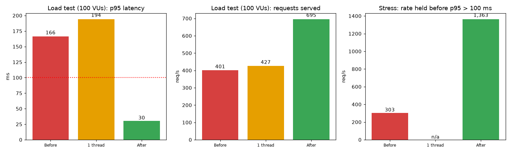
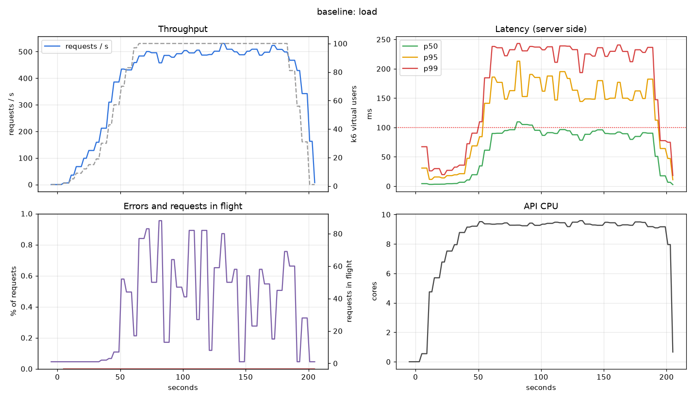
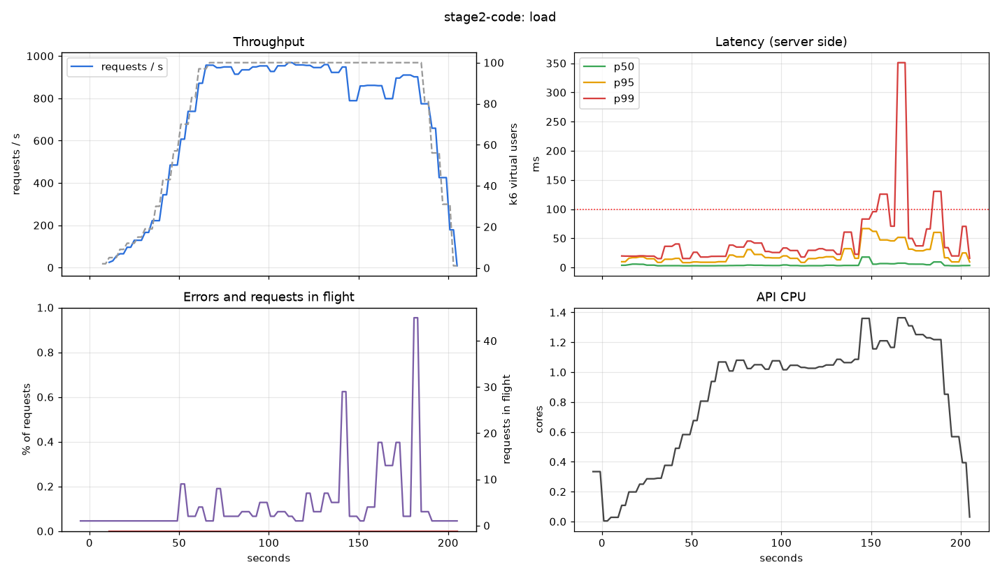
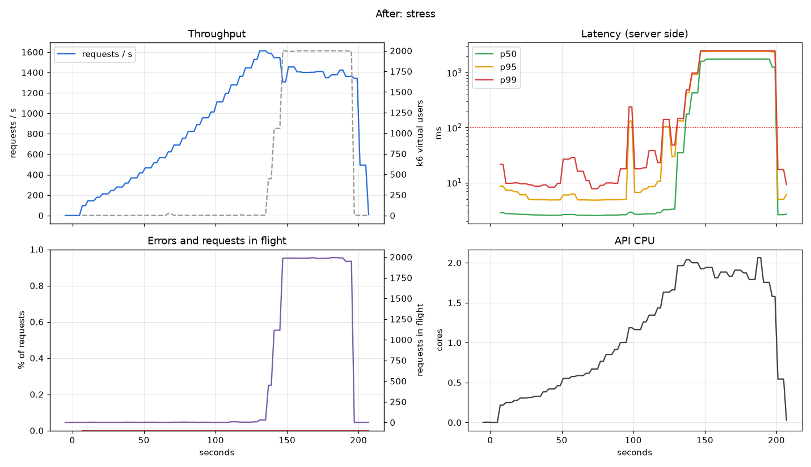

# Load test: ผลก่อนและหลังปรับปรุง

ทดสอบ `GET /recommend` ด้วย k6 และวัดฝั่ง server ด้วย Prometheus วิธีรันอยู่ใน [runbook-loadtest.md](runbook-loadtest.md)

**เป้าหมายที่ตั้งไว้:** p95 ต่ำกว่า 100 ms และ error ต่ำกว่า 1% ที่ traffic 100 VUs

## สรุป

| | ก่อน | หลัง |
| --- | --- | --- |
| Load test 100 VUs: p95 | 166 ms (**ไม่ผ่านเกณฑ์**) | **30 ms** (ผ่าน) |
| Load test: request ที่ให้บริการได้ | 401 / วินาที | **695 / วินาที** |
| Stress: อัตราที่ยังรักษา p95 < 100 ms ได้ | ~300 / วินาที | **~1,360 / วินาที** (4.5 เท่า) |
| Stress: p95 ตลอดการทดสอบ (ไต่ถึง 3,000/วินาที) | 6.4 วินาที | 1.6 วินาที |
| Error | 0% | 0% |
| CPU ของ API ตอน load test | **9.6 คอร์** | 1.4 คอร์ |

## วิธีทดสอบ

| Scenario | รูปแบบ | ใช้ทำอะไร |
| --- | --- | --- |
| smoke | 1 VU, 30 วินาที | เช็กว่าตอบถูก (ผ่าน: p95 27 ms, error 0%) |
| load | ไต่ถึง 100 VUs ใน 1 นาทีแล้วค้าง 2 นาที พักคิด 0.1 วินาที | traffic เป้าหมาย: เกณฑ์ p95 < 100 ms, error < 1% |
| stress | เพิ่มอัตรา 100 → 3,000 request/วินาที (โมเดล open) | หาจุดที่ระบบเริ่มพัง |

- **user id ที่ใช้:** 15% ผู้ใช้ที่ ALS รู้จัก, 35% มีประวัติใน Redis แต่ ALS ไม่รู้จัก, 50% เป็นผู้ใช้ใหม่ (สัดส่วนเอียงไปทาง cold เหมือนข้อมูลจริง) ไม่ใช่เลขสุ่มล้วน
- ทุกคำตอบถูกเช็กว่าได้ 10 รายการและ `source = ranker` (ถ้าไม่ใช่นับเป็นคำตอบผิด เกณฑ์ต้องเป็น 0)
- รัน `make replay` ก่อนเริ่ม แล้วใช้ Redis (ผู้ใช้ 1.28 ล้านคน) และโมเดลชุดเดียวกันทุกชุด k6 อ่านอย่างเดียว state จึงไม่เปลี่ยนระหว่างชุด
- จุดที่ระบบ "เริ่มพัง" หาจาก Prometheus: จุดแรกที่ p95 > 100 ms หรือ error > 1% ติดกัน 3 ช่วง (ช่วงละ 2 วินาที)

## สิ่งที่พบและที่มา

### 1. Baseline: ไม่ผ่านเกณฑ์ และกิน CPU ผิดปกติ

ที่ 100 VUs ได้ 401 request/วินาที p95 166 ms (ไม่ผ่าน) และ stress พังที่ ~300 request/วินาที

สิ่งผิดปกติในกราฟคือ **API ใช้ CPU ~9.4 คอร์ เพื่อรับแค่ ~500 request/วินาที** (ควรใช้ราว 1 คอร์) เพราะ numpy (BLAS) และ LightGBM (OpenMP) เปิด thread เท่าจำนวนคอร์ในทุก request เมื่อมีหลาย request พร้อมกัน thread เหล่านี้แย่งกันและวนรอกันเอง

### 2. ขั้นที่ 1: จำกัด thread (แก้แค่ค่าตั้งค่า `COMPUTE_THREADS=1`)

| | ก่อน | หลัง |
| --- | --- | --- |
| CPU ที่ใช้ | 9.6 คอร์ | **1.75 คอร์** |
| request / วินาที | 401 | 427 |
| p95 | 166 ms | 194 ms |

CPU ลดลง 5 เท่า แต่ **throughput แทบไม่ขึ้น** แปลว่าคอขวดจริงไม่ใช่ thread ของ numpy แต่เป็นเวลาที่ Python ใช้ต่อ request (ประมาณ 2 ms) การเปลี่ยนนี้ยังคงไว้เพราะคืน CPU ให้ส่วนอื่นของเครื่อง ไม่ได้ทำให้เร็วขึ้นด้วยตัวเอง

### 3. ขั้นที่ 2: ปรับโค้ดตามที่ profile ชี้

Profile ต่อ request บนโมเดลจริง (ผู้ใช้ 3 ประเภท):

| ประเภทผู้ใช้ | เวลาต่อ request (รวม Redis 1 รอบ) |
| --- | --- |
| ALS รู้จัก | 3.35 ms |
| มีประวัติ ALS ไม่รู้จัก | 1.21 ms |
| ใหม่ | 0.76 ms |

ส่วนที่กินเวลาและสิ่งที่แก้:

| คอขวด | แก้อย่างไร |
| --- | --- |
| สร้าง DataFrame polars 1 แถวเพื่อคำนวณฟีเจอร์ผู้ใช้ **~0.94 ms ต่อครั้ง** มากกว่าส่วนอื่นรวมกัน | คำนวณด้วย Python ล้วนด้วยสูตรเดียวกัน (test เทียบกับโค้ด offline) |
| วน 200 candidate × หา 4 key ใน hash ของผู้ใช้ | วนเฉพาะ field ใน hash ของผู้ใช้เอง |
| `@app.middleware("http")` ห่อทุก request ด้วย task เพิ่ม | เปลี่ยนเป็น ASGI middleware |
| ผู้ใช้ใหม่ (50% ของ traffic) ได้ candidate และฟีเจอร์ชุดเดียวกันหมด แต่คำนวณซ้ำทุกครั้ง | คำนวณรายการเรียงลำดับครั้งเดียวต่อโมเดลแล้วใช้ซ้ำ (test ยืนยันว่าคำตอบเท่าเดิมทุก k) |

ผลหลังปรับ:

| | Baseline | หลังปรับ |
| --- | --- | --- |
| request / วินาที | 401 | **695** |
| latency p50 / p95 / p99 | 93 / 166 / 195 ms | **2.8 / 30 / 70 ms** |
| เกณฑ์ | ไม่ผ่าน | **ผ่านทุกข้อ** |

### 4. Stress test หลังปรับ: จุดคอขวดใหม่

- ระบบรักษา p95 < 100 ms ได้จนถึง **~1,360 request/วินาที** (peak ที่ server เห็น 1,612) หลังจากนั้นคิวสะสม (requests in flight พุ่งไป 2,000 ซึ่งเป็นเพดาน VU ของ k6) และ latency ขึ้นเป็นวินาที
- **ไม่มี error เลยแม้ล้น** เพราะ request เข้าคิวรอ ไม่ถูกปฏิเสธ ระบบพังแบบ "ช้าลง" ไม่ใช่ "ตอบ error"
- API process เดียวใช้ CPU ได้ราว 2 คอร์ที่จุดอิ่มตัว เป็นเพดานของ process เดียว (GIL ของ Python)

## ข้อจำกัดของการวัด (อ่านก่อนอ้างตัวเลข)

- **ทุกอย่างรันบนเครื่องเดียว** (k6, API, Redis, Kafka, Prometheus, Grafana อยู่ใน Docker VM เดียวกัน 10 CPU) ตัวเลขเหมาะกับการเทียบก่อน/หลัง ไม่ใช่ความจุจริงบน production
- **วัดแต่ละชุดการตั้งค่าแค่รอบเดียว** ยังไม่ได้ประเมินความแปรปรวนระหว่างรอบ ความต่างเล็กๆ (เช่น 401 กับ 427 request/วินาที) ไม่ควรตีความ
- ขั้นที่ 2 รวมหลายการแก้ไว้ด้วยกัน ยังไม่ได้แยกว่าแต่ละอย่างช่วยกี่ %
- Stress ของขั้นที่ 1 (จำกัด thread อย่างเดียว) ไม่ได้รัน
- latency ฝั่ง server คำนวณจาก histogram bucket (ประมาณค่า) จึงต่างจากค่าที่ k6 วัดเล็กน้อย
- ไม่มี load shedding หรือ rate limit: เมื่อล้น ระบบเข้าคิวจน latency สูงมาก
- ยังไม่ได้ทดสอบกรณี Redis ช้า/ล่มภายใต้โหลด

## ต่อยอดได้ (ยังไม่ได้ทำ)
1. **หลาย worker** เพิ่มความจุได้อีกมาก แต่ต้องทำ Prometheus แบบ multiprocess และให้ `/admin/reload` แจ้งทุก worker (ตอนนี้มี worker เดียว)
2. ใส่ timeout และ load shedding ให้ตอบ 503 แทนการปล่อยคิวยาว
3. async Redis client เพื่อไม่ให้การรอ Redis บล็อก event loop
4. ลดงานของผู้ใช้ที่ ALS รู้จัก (3.35 ms ต่อ request): ส่วนใหญ่คือการคูณ factors กับสินค้าทั้ง 160K ตัว แก้ได้ด้วย ANN (เช่น Faiss) แต่ผลลัพธ์จะไม่เท่าเดิมเป๊ะ ต้องวัดผลต่อคุณภาพด้วย
